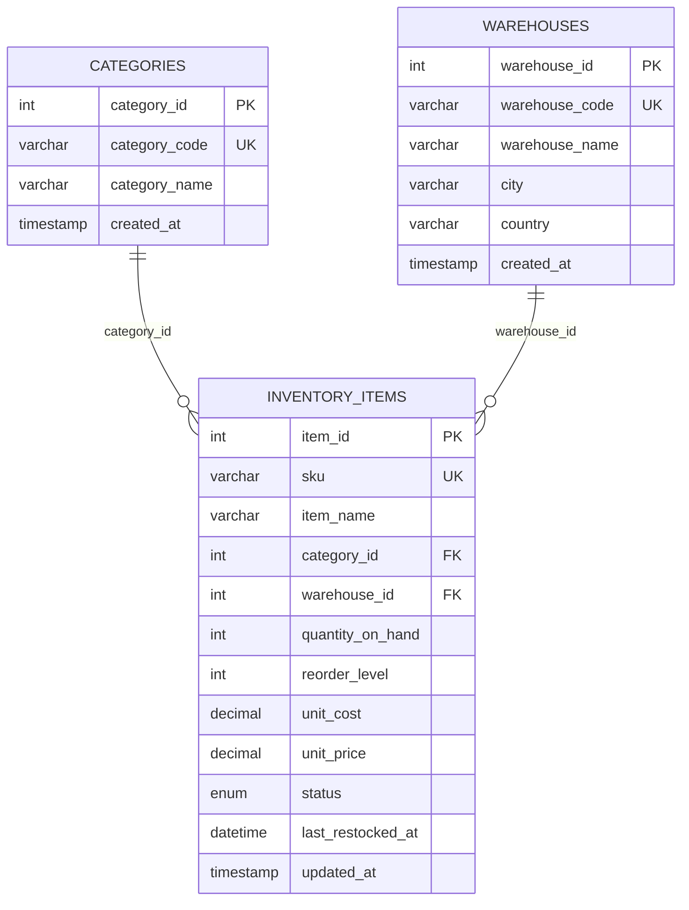

# inventory_db examples

Runnable mandryn examples against the `inventory_db` schema, demonstrating the
library's classic classes: `DBQuery`, `DBCommand`, `MagicInput` and `UniversalPaging`.

## Schema



## 1. Create and seed the database

From the repository root:

```bash
mysql -h 127.0.0.1 -u root < sql/inventory_db_generate.sql
mysql -h 127.0.0.1 -u root inventory_db < sql/inventory_db_seed.sql
```

- [`sql/inventory_db_generate.sql`](../../sql/inventory_db_generate.sql) — database + 3 tables
- [`sql/inventory_db_seed.sql`](../../sql/inventory_db_seed.sql) — 6 categories, 4 warehouses, 40 sample items (every status included)

Both scripts are idempotent (`IF NOT EXISTS` / `ON DUPLICATE KEY UPDATE`), so they
are safe to re-run.

## 2. Configure the connection

Edit `bootstrap.php` if your MySQL/MariaDB credentials differ from the Laragon
default (`root`, empty password).

## 3. Run the examples

```bash
php examples/inventory/01_list_items.php
php examples/inventory/02_paging.php
php examples/inventory/03_add_item.php
php examples/inventory/04_restock_item.php SKU-10002 60
php examples/inventory/05_low_stock_report.php
```

| Script | Demonstrates |
|---|---|
| `01_list_items.php` | `DBQuery` recordset with JOIN, `fetchRow`, `getRowsInJSON` |
| `02_paging.php` | `UniversalPaging` AUTO_VIRTUAL (walks every page) and MANUAL (single page with caller-supplied totals) |
| `03_add_item.php` | `MagicInput` definition + validation, `DBCommand` INSERT via `importInputColumns` |
| `04_restock_item.php` | `DBCommand` UPDATE with a `WHERE` condition and constants (`IFieldType`, `IComparisonType`, `IConditionOperator`) |
| `05_low_stock_report.php` | `DBQuery` reporting with `yieldRow` and grouped summary |

> `03` inserts a new SKU and `04` changes a row's quantity — they are meant to run
> against a development copy of the database.
